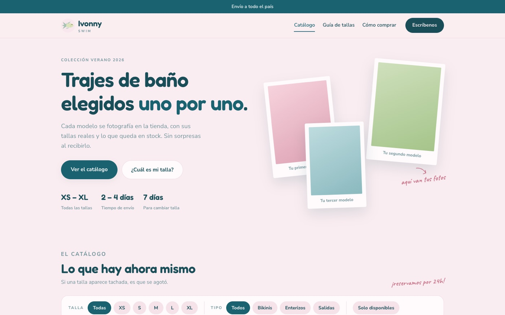
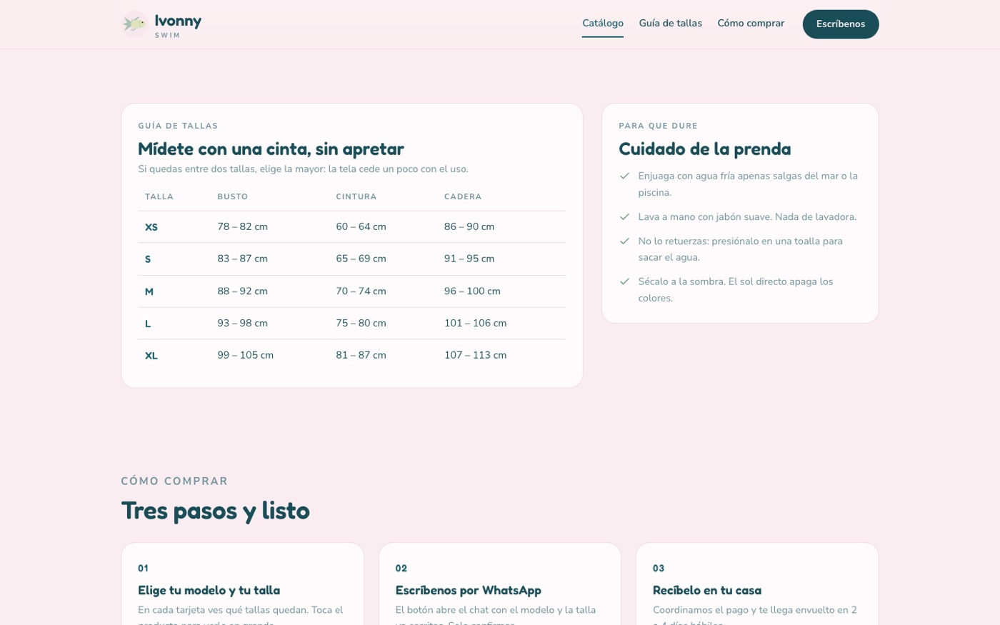
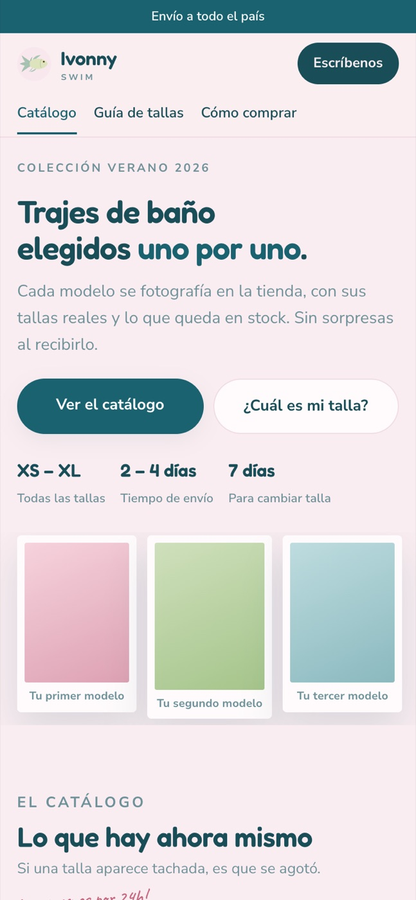

# Ivonny Swim

<!-- teaser:start -->
<p align="center">
  
</p>

<!-- teaser:end -->

Tienda web real de trajes de baño, en producción: **https://ivonny-swim.vercel.app**

La dueña del negocio administra su catálogo desde el teléfono con un panel propio, sin tocar código.

## Qué incluye

- Catálogo público con filtros por talla y por tipo, guía de tallas y pasos de compra por WhatsApp.
- Panel en `/admin`: alta y edición de productos y fotos, con sesión guardada en el teléfono.
- Desbloqueo del panel con Face ID (WebAuthn) como comodidad de acceso.
- Seguridad por fila en la base de datos: cualquiera lee el catálogo, solo quien inicia sesión escribe (`esquema.sql`).

## Stack

HTML, CSS y JavaScript sin framework · Supabase (base de datos, autenticación y almacenamiento de fotos) · Vercel (hosting).

## Cómo correrlo

```bash
# sirve la carpeta con cualquier servidor estático
npx serve .
```

Para usar tu propio backend: crea un proyecto en Supabase, ejecuta `esquema.sql` y reemplaza las claves públicas de `config.js` por las tuyas. Las claves de ese archivo son públicas por diseño; lo que protege los datos son las políticas del esquema.
